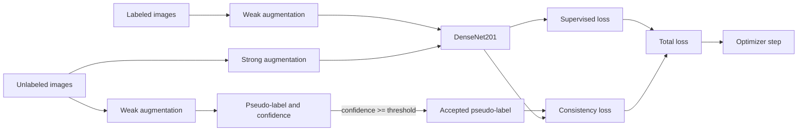

# FixMatch for Image Classification

> A configurable PyTorch reference notebook for semi-supervised image classification with weak/strong augmentation and confidence-filtered pseudo-labels.

**Initial implementation:** April 2025<br>
**Repository status:** Research reference implementation

## Why this repository exists

Expert annotation is expensive in medical imaging, agriculture, and other specialized domains. FixMatch combines a small labeled set with a larger unlabeled set by generating pseudo-labels from weakly augmented images and enforcing consistent predictions on strongly augmented versions.

This repository provides a domain-adaptable notebook that exposes the complete experimental path: data discovery, labeled/unlabeled splitting, augmentation, DenseNet201 configuration, FixMatch training, checkpointing, and evaluation.

## Method overview



## Repository contents

```text
.
├── Fix_Match_Algorithm.ipynb  # End-to-end Colab-oriented workflow
├── CITATION.cff               # Software citation metadata
├── requirements.txt           # Core Python dependencies
└── README.md
```

## Notebook workflow

1. Mount or locate the dataset.
2. Index images by class folder.
3. Split examples into labeled, unlabeled, validation, and test sets.
4. Apply weak and RandAugment-style strong transformations.
5. Fine-tune a DenseNet201 classifier.
6. Accept pseudo-labels above a configurable confidence threshold.
7. Combine supervised and unsupervised losses.
8. Save the best checkpoint and evaluate class-wise performance.

## Setup

The notebook is designed for Google Colab or a CUDA-capable local environment.

```bash
python -m venv .venv
# Windows: .venv\Scripts\activate
# Linux/macOS: source .venv/bin/activate
pip install -r requirements.txt
jupyter notebook Fix_Match_Algorithm.ipynb
```

Before training, configure these notebook values:

- `root_dir`: dataset directory containing one subdirectory per class.
- `label_map`: mapping from directory names to integer labels.
- `total_class`: number of target classes.
- `threshold_value`: minimum confidence for accepting a pseudo-label.
- batch sizes, checkpoint path, learning rate, and labeled-data ratio.

Expected dataset layout:

```text
dataset/
├── class_a/
│   ├── image_001.jpg
│   └── image_002.jpg
├── class_b/
└── class_c/
```

## Reproducibility note

This is a configurable reference notebook rather than a packaged reproduction of one publication. Dataset paths and class mappings are intentionally placeholders, and trained weights or private/controlled datasets are not distributed here. Any reported paper result should be cited from its publisher record and reproduced with the corresponding dataset protocol.

## Research context

This implementation supports the broader investigation of label efficiency represented by:

- **A FixMatch Framework for Alzheimer's Disease Classification: Exploring the Trade-Off Between Supervision and Performance**<br>
  *IEEE Access* · **Published April 2025** · [DOI](https://doi.org/10.1109/ACCESS.2025.3556964)

- **Enhancing Cervical Cancer Detection: Leveraging Semi-Supervised Learning for Improved Prognosis**<br>
  *ICCIT* · **Published December 2024** · [DOI](https://doi.org/10.1109/ICCIT64611.2024.11022402)

The algorithm was introduced in:

> Sohn, K. et al. “FixMatch: Simplifying Semi-Supervised Learning with Consistency and Confidence.” *NeurIPS*, 2020. [Paper](https://proceedings.neurips.cc/paper/2020/hash/06964dce9addb1c5cb5d6e3d9838f733-Abstract.html)

## Limitations

- Performance is sensitive to class balance, confidence threshold, augmentation policy, and labeled-data ratio.
- Pseudo-label errors can reinforce themselves when early predictions are poorly calibrated.
- Medical or agricultural predictions require domain-specific validation and should not be treated as professional diagnosis.
- The current notebook prioritizes experimental clarity; modular training scripts and automated tests are planned improvements.

## Citation

Use the repository citation available through GitHub's **Cite this repository** control or cite the relevant publication above when using a paper-specific result.

## Author

**Md Tahsin** · [GitHub](https://github.com/T-biohazard) · [Google Scholar](https://scholar.google.com/citations?user=6zm80xAAAAAJ&hl=en)
